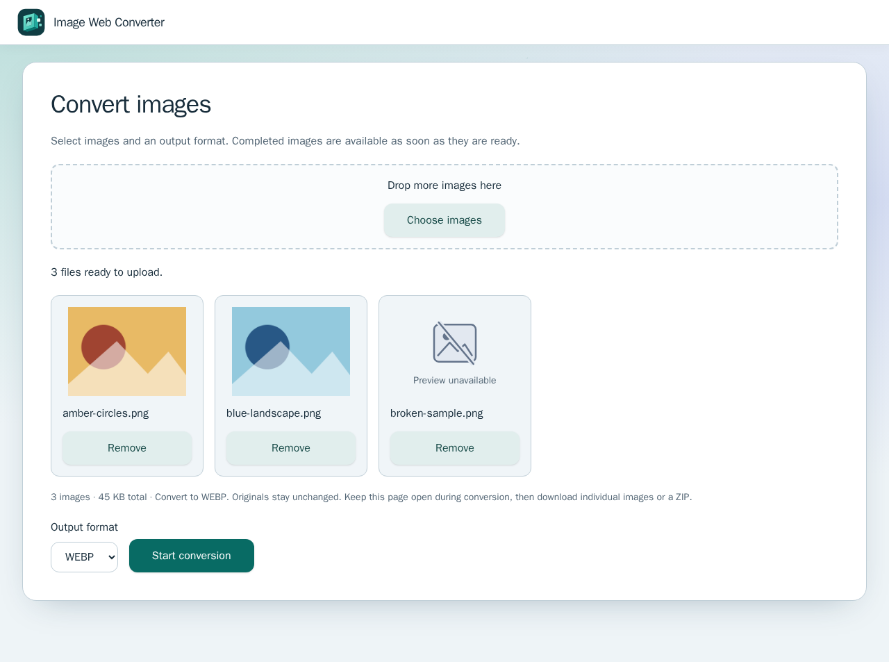
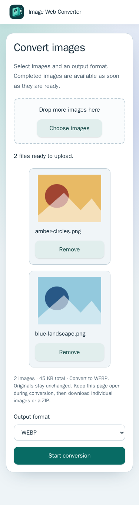
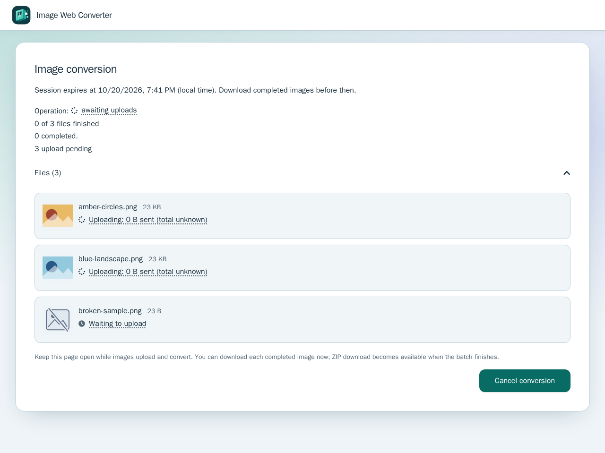
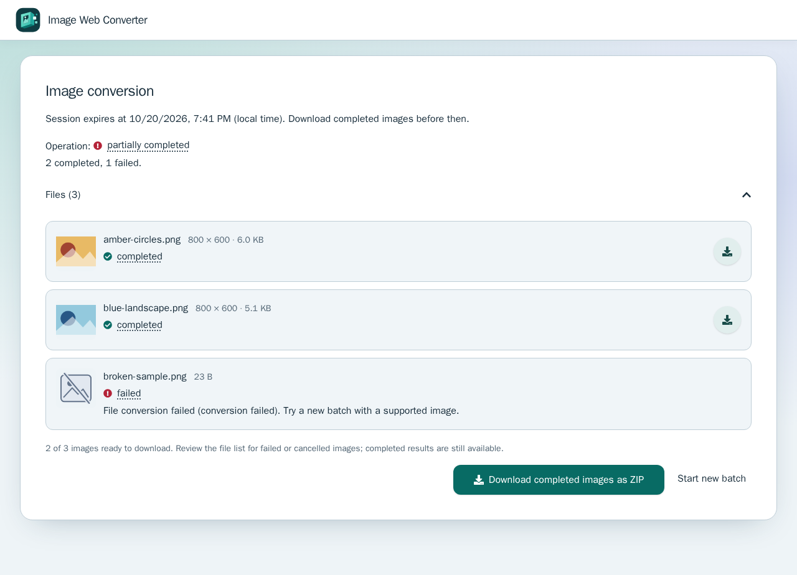
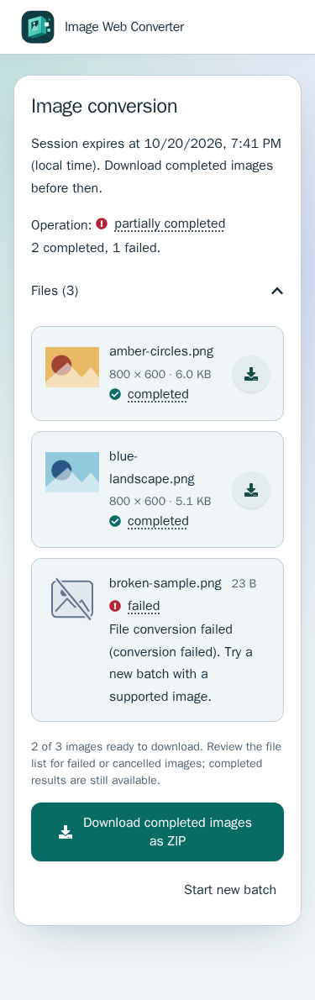
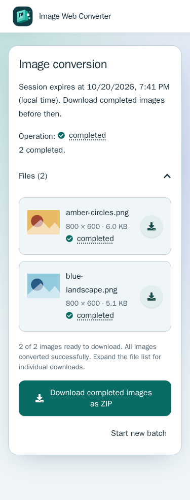

# Conversion screenshots

These PNGs were captured on **2026-10-20** from the built React Router SSR app
and a real production API process using Playwright **1.64.1 / Chromium 156.0.8078.4
(revision 1248)**. The
test fixture routes `/api` to that API and all other requests to the SSR
process. It does not synthesize conversion responses. The images are generated
synthetic PNG geometry; the broken sample contains invalid image bytes so the
API produces a genuine partial result. No personal images, bearer tokens,
network traces, or videos are retained.

| Stage           | Desktop                                                                                              | Mobile (375 × 812)                                                                        |
| --------------- | ---------------------------------------------------------------------------------------------------- | ----------------------------------------------------------------------------------------- |
| Selection       |  |                  |
| Upload          |                     | —                                                                                         |
| Partial results |                  |         |
| Completed       | —                                                                                                    |  |

The upload capture holds real HTTP upload requests briefly to make the pending
state reproducible, then releases them to the API. The displayed session expiry
is local to the capture run.

To recapture from a clean checkout on the validated Node/npm platform:

```sh
npm ci
NX_SKIP_NATIVE_FILE_CACHE=true NX_DAEMON=false npm run build
./node_modules/.bin/playwright test --config apps/web-e2e/screenshot.config.ts
```

The screenshot target is separate from the normal browser suites. It overwrites
only the six PNGs in this directory. Review the images for accidental private
content before publishing them.
