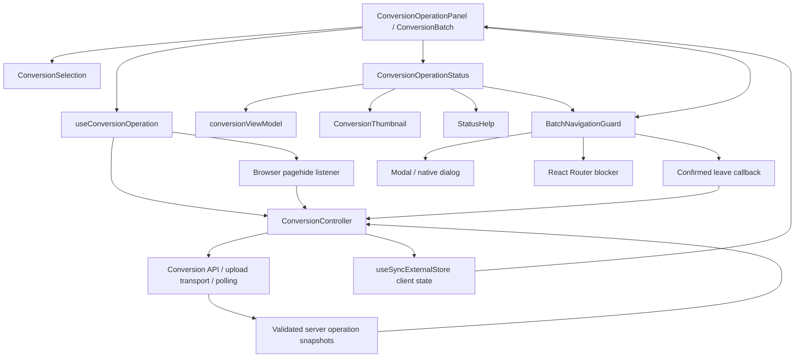

# Conversion workflow UI: features, testing seams, and validation

This document describes the conversion UI changes committed in `f217d97`
(`Improve conversion status, downloads, and batch navigation`). It maps the
implemented behavior to production components, automated tests, and remaining
validation gaps. It supplements the [use-case inventory](use-case-inventory.md);
it does not replace that inventory or claim exhaustive branch coverage.

## Component connections and ownership



| Component / source                   | Owns                                                                               | Important connections and boundaries                                                                                                                      |
| ------------------------------------ | ---------------------------------------------------------------------------------- | --------------------------------------------------------------------------------------------------------------------------------------------------------- |
| [ConversionOperationPanel][panel]    | Batch selection versus submitted UI; session/error boundaries; new-batch remount   | Supplies controller state and command callbacks to results. A confirmed new batch increments the boundary key and creates a fresh session provider.       |
| [ConversionSelection][selection]     | Pending files, format control, pre-conversion summary                              | Receives selected local files from `useFileItems`. Computes total input bytes and displays the chosen output format; does not infer conversion outcomes.  |
| [useConversionOperation][hook]       | Controller subscription and browser lifecycle wiring                               | Uses `useSyncExternalStore`; connects/disconnects the controller; registers `pagehide`; exposes `leave: controller.pageExit`.                             |
| [ConversionController][controller]   | Commands, local upload attempts, download/cancel flags, errors, accepted snapshots | Existing service-injection seam supports isolated tests. Cleanup stops polling/uploads and aborts requests. Cleanup itself does not request cancellation. |
| [conversionViewModel][view-model]    | Terminal-state detection, retry eligibility, file labels, completed outputs        | Local upload labels apply to `awaiting_upload`; authoritative server states determine outcomes.                                                           |
| [ConversionOperationStatus][results] | Aggregate display, per-file rows, accordion state, selected download target        | Receives immutable snapshots and command callbacks. Uses server counts for outcomes and current file states for pending/queued counts.                    |
| [ConversionThumbnail][thumbnail]     | Local preview and fallback, thumbnail download trigger                             | Calls the same download wrapper as the row icon; it does not fetch results itself.                                                                        |
| [StatusHelp][help]                   | Icons, underlined trigger, dark tooltip, positioning and dismissal                 | Portals into `document.body` so the accordion's overflow container does not clip help.                                                                    |
| [BatchNavigationGuard][guard]        | Route blocking, restart confirmation, unload warning                               | Uses a data-router blocker when that context exists. Delegates presentation to `Modal` and cancellation to the supplied leave callback.                   |
| [Modal][modal]                       | Controlled native dialog, accessible title, Escape handling, Tab wrapping          | Native `showModal()` supplies background inertness and focus restoration; explicit keyboard handling wraps first/last visible enabled controls.           |
| [Conversion schemas][schemas]        | API snapshot shape and invariants                                                  | Validates counts against file records, terminal/settled consistency, identity and timestamps. The browser count fixtures use this schema too.             |

There are three distinct kinds of state:

- **Server outcome state:** operation/file statuses, counts, outputs and expiry.
- **Local command/transfer state:** uploads and byte progress, `downloading`,
  `cancelling`, transport errors and connection state.
- **Presentation state:** expanded file list, active tooltip, confirmation dialog,
  and which image/ZIP initiated the current download.

Tests must not treat bytes sent, clicking Cancel, or a failed download as a new
server conversion outcome. Snapshot revision/identity checks prevent older
responses from rolling authoritative outcomes backward.

## Implemented feature contracts

### Download feedback

The row icon, thumbnail, and ZIP action call the results component's download
wrapper. A single-image request records `result.meta.id`; ZIP records `zip`.
The controller's `downloading` flag supplies the pending lifetime.

- Only the selected target's icon becomes a spinner. Clicking a thumbnail spins
  its corresponding row download icon; the thumbnail itself remains a preview.
- All image/thumbnail/ZIP download controls are disabled while any download is
  pending, or when session access has ended.
- Image and ZIP buttons expose `aria-busy` for the selected pending target.
  A live message says the image or ZIP is being prepared.
- Clearing `downloading` restores the icon and controls, including after a
  recoverable download failure. Conversion counts remain unchanged.
- Individual completed outputs are downloadable during conversion. ZIP appears
  only after a terminal snapshot and only if at least one output exists.
- The loader represents fetching/preparing the browser download, not a measurable
  percentage or proof that the user saved a file to disk. Successful downloads
  do not remove the later results-loss warning.

**Automated evidence:** [status tests][status-tests], especially the parameterized
`shows a loader only for the pending ... download and clears it on failure`;
[panel tests][panel-tests] for failed-download retry and disabled controls;
[count tests][counts-unit] for outcome invariance; [transport tests][transport-tests]
for output downloading/object URL cleanup; [real-API conversion tests][real-conversion]
for decoded images and ZIP contents.

### Status labels and help

Page and file labels use a dotted underline with an icon. Text remains available
independently of color or motion. Page tone is busy while active, success when all
files have completed in a terminal batch, and warning for other terminal outcomes.
File tone is success for completed, warning for failed/cancelled/retryable upload
states, busy for processing or a remaining local `sending` state, and waiting
otherwise. `fileDisplayState` supplies the displayed file text.

`StatusHelp` opens on mouse hover, focus, or click/tap. It uses `role="tooltip"`
and connects the trigger with `aria-describedby` while open. Escape and blur
close it; mouse departure uses a 150 ms delay to allow moving onto the tooltip.
Scroll/resize dismiss it. Unmount removes listeners and clears the hide timer.
Its fixed portal placement is bounded using the viewport dimensions. Spinners
use `motion-safe:animate-spin`.

**Automated evidence:** [status tests][status-tests] exercise upload/server label
variants, server-state precedence, and focus/Escape help. The progressive-results
case in [browser upload integration][browser-upload] verifies focus, Escape,
hover departure, scroll dismissal and viewport bounds in real browsers. Touch,
resize, timer and icon-color branches remain in the gap checklist.

### Navigation protection and modal lifecycle

| User action                                            | Implemented behavior                                                                                                                           | Test boundary                                                                                               |
| ------------------------------------------------------ | ---------------------------------------------------------------------------------------------------------------------------------------------- | ----------------------------------------------------------------------------------------------------------- |
| Navigate within the app from an active submitted batch | `useBlocker(true)` opens “Leave this conversion?”. Stay resets the blocker. Confirm calls `onLeave`, then proceeds.                            | Data-router component tests plus browser Home → Stay interaction.                                           |
| Navigate within the app from a terminal batch          | Opens “Leave these results?” with download-before-leaving guidance. Confirm proceeds.                                                          | Component tests run both active and terminal cases.                                                         |
| Start a new batch from terminal results                | Opens the results-loss dialog. Only confirmation calls `onNewBatch`; the parent then remounts the batch/session boundary.                      | Guard tests, panel fresh-session tests, browser restart test.                                               |
| Reload or close the document                           | `beforeunload` requests the browser's own warning. Its wording and whether it is shown are browser-controlled.                                 | Component event tests verify prevention and listener cleanup; manual browser confirmation remains relevant. |
| Actually exit the document                             | The hook's existing `pagehide` listener invokes `controller.pageExit`. For an accessible active operation this sends best-effort cancellation. | Controller/transport tests and real-API page-exit tests.                                                    |
| Rerender, Strict Mode cleanup, or ordinary unmount     | Controller cleanup stops local work; it does not itself send cancellation. An explicitly confirmed route leave has already invoked `pageExit`. | Panel/controller lifecycle regression tests.                                                                |

The guard is also mounted while a batch is submitted but no operation snapshot
has arrived. Cancellation can only be requested when the controller has an
accessible, nonterminal operation; leaving during an unresolved creation request
cannot guarantee cancellation. Terminal exit does not send a cancellation
request. Remaining server processing may complete even after a request to cancel.

The React Router blocker is mounted only when `UNSAFE_DataRouterContext` exists.
A plain `MemoryRouter` test does **not** exercise route blocking; the dedicated
[guard tests][guard-tests] use `createMemoryRouter` and `RouterProvider`.
The initial unsubmitted selection does not mount this guard. Existing recovery
buttons for rejected/inaccessible creation remain a separate path.

The dialog initially focuses “Stay on this batch”. Escape invokes the controlled
close/stay callback. Tab and Shift+Tab wrap between visible, enabled, non-inert
controls. Native close restores focus. Backdrop clicking is not implemented as a
dismissal action. There is no modal queue or global modal provider.

**Automated evidence:** [guard tests][guard-tests], [panel tests][panel-tests],
[controller tests][controller-tests], [transport tests][transport-tests],
[browser upload integration][browser-upload], and [real lifecycle tests][real-lifecycle].
The browser restart test checks autofocus, wrapping in both directions, Escape,
focus return, and confirmed restart. Browser history tests cover Back/Forward
while creation is unresolved. [Generic modal component tests][modal-tests]
cover absent, disabled, hidden and inert controls plus close/reopen/unmount;
jsdom cannot establish native top-layer behavior. The original browser run found
a Tab-wrap failure; explicit wrapping was added and that case passed on rerun.

### Counts and summaries

| Display                                   | Source and meaning                                                                    | Visibility                          |
| ----------------------------------------- | ------------------------------------------------------------------------------------- | ----------------------------------- |
| `S of N files finished`                   | `counts.settled` / `counts.expected`; settled includes completed + failed + cancelled | Active batches only                 |
| `C completed`                             | `counts.completed`; completed means a server result exists                            | Always, including zero              |
| `F failed`, `X cancelled`, `P processing` | Corresponding authoritative counts                                                    | Each shown only when nonzero        |
| `U upload pending`                        | Number of files currently `awaiting_upload`                                           | Active batches, nonzero only        |
| `Q queued`                                | Number of files currently `uploaded`                                                  | Active batches, nonzero only        |
| `Files (N)`                               | `operation.files.length`                                                              | Accordion toggle                    |
| `C of N images ready to download`         | Completed output list length / operation file list length                             | Terminal batches                    |
| Selection summary                         | Selected local file count, sum of `file.size`, current output MIME label              | Before submission, when files exist |

**Important:** API `counts.uploaded` is cumulative. It includes files that have
moved into processing or finished after upload. It is **not** the current queue
size. The UI derives queued count from `file.status === 'uploaded'` instead.
Likewise, sending every byte does not prove upload acceptance or conversion
success; local upload errors do not increment `counts.failed`.

On terminal snapshots the live progress fraction, upload-pending and queued
labels disappear. Valid terminal snapshots have no processing files, so that
count disappears too. Completion keeps outcome counts and download guidance.
Partial outcomes direct the user to the file list. Zero-output outcomes explicitly
say no images are available and offer guidance to start another batch. During
active cancellation, pending cancellation is displayed without inventing a
terminal status; completed outputs can survive cancellation.

The pre-conversion summary sits below selected files and before the format/start
controls. It describes input count/bytes, chosen format, unchanged originals,
keeping the page open, and individual/ZIP downloads. The active-results summary
explains progressive downloads and ZIP availability; the terminal summary explains
available results. Expiry remains displayed in local time above the statuses.

#### Count coverage matrix

[ConversionCounts.spec.tsx][counts-unit] contains 16 component test cases.
[counts.spec.ts][counts-browser] supplies six browser transition scenarios.
The following are assertions to preserve, not just example screenshots:

| Scenario                                                       | Expected behavior                                                                                                   | Existing evidence                                                             |
| -------------------------------------------------------------- | ------------------------------------------------------------------------------------------------------------------- | ----------------------------------------------------------------------------- |
| Two files awaiting upload                                      | `0 of 2 files finished`, `0 completed`, `2 upload pending`; no zero-valued queue/error counters                     | Unit live-state matrix; browser initial state uses four files                 |
| One waiting, one uploaded                                      | One upload pending and one queued; no finished results                                                              | Unit live-state matrix                                                        |
| All uploaded, not processing                                   | Current queue equals file count; no upload-pending label                                                            | Unit and all six browser scenarios                                            |
| Processing with siblings queued                                | Processing file is excluded from queue even though cumulative uploaded includes it                                  | Unit and all six browser scenarios                                            |
| Completed + processing + queued                                | Finished numerator and completed count increment; queue decreases independently                                     | Unit and progressive browser scenarios                                        |
| Completed + failed + cancelled + processing + queued + pending | Settled counts the three terminal files; all live categories remain distinct                                        | Six-file unit matrix case                                                     |
| All successful                                                 | Completed count equals total, live-only counts vanish, ZIP exists, accordion closes                                 | Unit and successful browser scenario                                          |
| Partial failure                                                | Completed/failed counts remain separate; only completed outputs are ready; list stays open by default               | Unit, browser partial failure, real-API decode failure                        |
| All failed                                                     | Zero completed, all failed, no ZIP, explicit no-results guidance                                                    | Unit and browser all-failed scenario                                          |
| Cancellation with active processing                            | Cancelled siblings count as finished; active file still processing; pending message remains until terminal snapshot | Dedicated unit case, both browser cancellation scenarios, real lifecycle test |
| Cancellation with/without results                              | Correct completed/cancelled totals; ZIP only if completed results exist                                             | Unit terminal matrix and both browser cancellation scenarios                  |
| Processing timeout                                             | Partial terminal outcomes preserved; no residual live counts; timeout alert                                         | Unit timeout case and browser timeout scenario                                |
| Local upload failure or stale upload state                     | Local errors/bytes never fabricate failed/completed outcomes; server labels prevail                                 | Unit count case and status/controller tests                                   |
| Polling/access error                                           | Supplied authoritative counts remain intact; access expiry disables downloads                                       | Unit count case; controller expiry/backoff tests cover surrounding behavior   |
| Download pending/failure and accordion toggling                | No change to authoritative outcome counts                                                                           | Dedicated unit invariance case                                                |
| Selection removal/format change/empty selection                | Count, bytes and format update; summary/start control disappear when empty                                          | Dedicated selection-summary unit case                                         |

The browser scenarios intercept HTTP at the Playwright route seam. They create
and upload a four-file batch, drive queued and processing snapshots, and finish
as success, partial failure, total failure, cancellation with results,
cancellation without results, or timeout. Every fixture is parsed by
`ApiConversionOperationSchema`; assertions use explicit expected numbers and
check per-file terminal labels as well as aggregates. The tests deliberately
separate snapshot delivery from local transfer progress. Their fixed scenario
matrix accounts for the documented conditional-test lint exceptions.

### Collapsible result list

`ConversionOperationStatus` starts expanded. Its automatic-success predicate is
**nonempty file list + terminal operation + every file completed**; it is not
merely `operation.status === 'completed'`, nor does it require the absence of
independent command-error messages. A change to successful completion closes the
panel. Users can reopen it, and later snapshot revisions with the same success
predicate do not close it again.

The toggle exposes `aria-expanded` and `aria-controls`. Collapsed content is
`inert` and `aria-hidden`; a CSS grid row transition animates over 300 ms only
when motion is permitted. If focus is inside the list when automatic collapse
occurs, it moves to the toggle. ZIP/actions remain outside the collapsing region.

Failures/cancellations leave the initially expanded list open. They do not force
a manually closed active list to reopen if the success predicate stays false.
This distinction matters when designing additional error-discovery behavior.

**Automated evidence:** [status tests][status-tests] cover close/reopen, stable
revisions and error outcomes; [count tests][counts-unit] verify terminal visibility;
[browser count scenarios][counts-browser] verify default expansion by outcome;
[browser upload integration][browser-upload] verifies reopening, controls,
focus transfer on automatic collapse, keyboard exclusion of hidden rows,
reduced-motion accordion behavior, and layout. A 20-file browser case checks ZIP
viewport proximity after collapse; animation duration remains unmeasured.

## Testing seams and what each level proves

| Level / seam             | Test setup                                                                              | What is real                                                                                 | What it cannot establish alone                                            |
| ------------------------ | --------------------------------------------------------------------------------------- | -------------------------------------------------------------------------------------------- | ------------------------------------------------------------------------- |
| Presentational component | Render status/selection with snapshot props and callback spies; rerender on transitions | React state/effects, labels, counts, DOM semantics                                           | Network scheduling, browser layout, real downloads                        |
| Controller               | Inject services, deferred promises and snapshots                                        | Command lifecycle, revision rejection, retries, expiry, state updates                        | Browser affordances or real conversion correctness                        |
| Mounted panel            | Real hook/controller with mocked fetch/XHR and local files                              | Selection → submission → results, session remount, download-error recovery, lifecycle wiring | Native dialog focus behavior or visual animation                          |
| Data-router guard        | `createMemoryRouter` + `RouterProvider`; navigation and beforeunload events             | Blocker reset/proceed and callbacks                                                          | Browser-native unload prompt or OS/browser focus behavior                 |
| Browser integration      | Production web build; Playwright interception; schema-valid controlled snapshots        | Browser DOM, routing, focus, layout, keyboard interaction and snapshot rendering             | Real API scheduler/converter correctness                                  |
| Real-API E2E             | Built web/API and controlled API fixture where needed                                   | Actual conversion, progressive results, cancellation, retries, downloaded image/ZIP decoding | Exhaustive formats, all OS/browser combinations, persistence after saving |

[setupTests.tsx][test-setup] implements jsdom `showModal()`/`close()` by toggling
`open`. It does **not** emulate top-layer rendering, native background inertness,
focus trapping, or focus restoration. Guard/component tests passing therefore
cannot replace the real-browser modal test. Likewise, CSS `motion-safe` classes
are implementation evidence, not proof that motion preferences were exercised
for these new controls.

## Validation commands

Run from the repository root using the existing npm lockfile and installed
project tools. Do not add production dependencies to run these checks.

```bash
# Unit/component tests, type checks, lint and production build.
NX_NO_CLOUD=true npx nx run-many -t test,typecheck,lint,build -p web,web-e2e --outputStyle=static

# Focused count component suite, if investigating a regression.
npx vitest run --config apps/web/vite.config.ts app/routes/conversion/__tests__/ConversionCounts.spec.tsx

# Build prerequisites before invoking Playwright directly.
NX_NO_CLOUD=true npx nx run web:build
NX_NO_CLOUD=true npx nx run api-e2e:build-fixture

# Chromium browser integration (includes the six count scenarios).
npx playwright test --config apps/web-e2e/browser-integration.config.ts --project chromium --reporter=line

# Focused count transitions or modal/accordion regression.
npx playwright test --config apps/web-e2e/browser-integration.config.ts --project chromium --grep 'counts remain accurate' --reporter=line
npx playwright test --config apps/web-e2e/browser-integration.config.ts --project chromium --grep 'route creates a manifest' --reporter=line

# Real-API end-to-end suite.
npx playwright test --config apps/web-e2e/playwright.config.ts --project chromium --reporter=line

# Repository targets for configured browsers, when all browser prerequisites exist.
NX_NO_CLOUD=true npx nx run web-e2e:browser-integration
NX_NO_CLOUD=true npx nx run web-e2e:e2e

git diff --check
```

The implementation session installed browser binaries under the ignored
`tmp/playwright-browsers` directory. To reuse that location, set
`PLAYWRIGHT_BROWSERS_PATH="$PWD/tmp/playwright-browsers"` for **both** installation
and execution. For example:

```bash
PLAYWRIGHT_BROWSERS_PATH="$PWD/tmp/playwright-browsers" npx playwright install chromium
PLAYWRIGHT_BROWSERS_PATH="$PWD/tmp/playwright-browsers" npx playwright test --config apps/web-e2e/browser-integration.config.ts --project chromium --reporter=line
```

A browser binary download does not install missing operating-system libraries.
Browser integration and real-API E2E have separate test configurations and output
directories under `apps/web-e2e/test-output/`. Check the process exit code and final
summary; startup lines, generated server logs, or the existence of artifacts are
not evidence that tests passed.

## Recorded validation and remaining checks

The implementation-session results for `f217d97` were:

- **109 web unit/component tests passed**, including 16 dedicated count cases.
- **22 Chromium browser integration cases validated:** 21 passed in the full run;
  the modal Tab-wrap case initially failed, was fixed, and passed in a focused
  rerun. This is not a claim of a second uninterrupted 22-case run after that fix.
- **9 Chromium real-API E2E cases passed.** These cover output formats, partial
  decode failure, interrupted-upload retry and cancellation/page-exit behavior.
- Build, type checks, lint and diff whitespace checks passed. Lint retained the
  existing `no-explicit-any` warning in `apps/web/app/root.tsx`; the build also
  reported existing warning output.
- The initial all-browser attempt could not launch missing browser binaries.
  After workspace-local installation, Chromium launched; Firefox/WebKit still
  lacked system libraries. **Firefox/WebKit behavior is unverified**, not passed.

These are historical results, not fresh execution claims for future revisions.
This document was added afterward; it does not provide a coverage percentage or
replace CI logs. The following checks remain useful to close specific gaps:

| Gap                               | Required verification                                                                                                                                                                            |
| --------------------------------- | ------------------------------------------------------------------------------------------------------------------------------------------------------------------------------------------------ |
| Cross-browser behavior            | Focused PF-16 cases now pass in all three engines; run the complete integration and real-API suites again for final release verification.                                                        |
| New-control motion preferences    | Spinner and accordion reduced-motion behavior and the permitted accordion transition duration are covered in all three browser engines.                                                          |
| Tooltip lifecycle                 | Focus, Escape, hover departure, scroll dismissal, narrow viewport placement, and tap opening are covered in browsers. Add resize and unmount cleanup checks.                                     |
| Generic modal variations          | Component tests cover absent, disabled, hidden and inert controls plus close/reopen/unmount. Native top-layer focus is checked for the creation warning; other variations need browser evidence. |
| Automatic collapse focus transfer | Browser integration now focuses an image download during processing, then verifies toggle focus and keyboard exclusion of the collapsed row after completion in all three engines.               |
| Long-list layout                  | A 20-file success case confirms ZIP is in the narrow viewport after collapse. Permitted transition duration is checked; scroll during animation remains unverified.                              |
| Navigation variants               | Back/Forward stay/leave and dismissed reload during unresolved creation are covered in all three engines. Accepted reload and tab close need a browser/manual pass.                              |
| Screen-reader experience          | Verify announcements, tooltip descriptions and the second live region during download with an actual assistive technology.                                                                       |
| Download feedback in the browser  | Real-API browser tests now hold image and ZIP responses, verify busy/disabled state and reduced-motion spinner, then check error recovery and a completed ZIP download in all three engines.     |

For review, confirm that every changed contract above retains a test at the level
where it can actually fail. In particular: keep snapshot counts schema-valid,
assert queue versus cumulative-upload semantics, test active-to-terminal rerenders,
and use browser assertions for native dialog and focus behavior rather than
extending the jsdom mock to pretend those behaviors work.

[panel]: ../../apps/web/app/routes/conversion/components/ConversionOperationPanel.tsx
[selection]: ../../apps/web/app/routes/conversion/components/ConversionSelection.tsx
[hook]: ../../apps/web/app/routes/conversion/hooks/useConversionOperation.ts
[controller]: ../../apps/web/app/routes/conversion/conversionController.ts
[view-model]: ../../apps/web/app/routes/conversion/conversionViewModel.ts
[results]: ../../apps/web/app/routes/conversion/components/ConversionOperationStatus.tsx
[thumbnail]: ../../apps/web/app/routes/conversion/components/ConversionThumbnail.tsx
[help]: ../../apps/web/app/components/StatusHelp.tsx
[guard]: ../../apps/web/app/routes/conversion/components/BatchNavigationGuard.tsx
[modal]: ../../apps/web/app/components/Modal.tsx
[modal-tests]: ../../apps/web/app/components/Modal.spec.tsx
[schemas]: ../../libs/schemas/src/lib/api/conversions.ts
[status-tests]: ../../apps/web/app/routes/conversion/__tests__/ConversionOperationStatus.spec.tsx
[panel-tests]: ../../apps/web/app/routes/conversion/__tests__/ConversionOperationPanel.spec.tsx
[counts-unit]: ../../apps/web/app/routes/conversion/__tests__/ConversionCounts.spec.tsx
[counts-browser]: ../../apps/web-e2e/src/integration/counts.spec.ts
[guard-tests]: ../../apps/web/app/routes/conversion/__tests__/BatchNavigationGuard.spec.tsx
[controller-tests]: ../../apps/web/app/routes/conversion/__tests__/conversionController.spec.ts
[transport-tests]: ../../apps/web/app/routes/conversion/__tests__/conversionTransport.spec.ts
[browser-upload]: ../../apps/web-e2e/src/integration/upload.spec.ts
[real-conversion]: ../../apps/web-e2e/src/e2e/conversion.spec.ts
[real-lifecycle]: ../../apps/web-e2e/src/e2e/lifecycle.spec.ts
[test-setup]: ../../apps/web/app/setupTests.tsx
